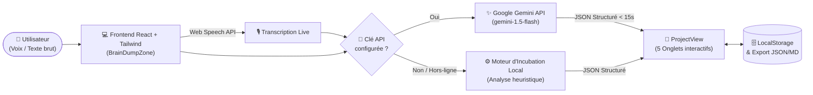
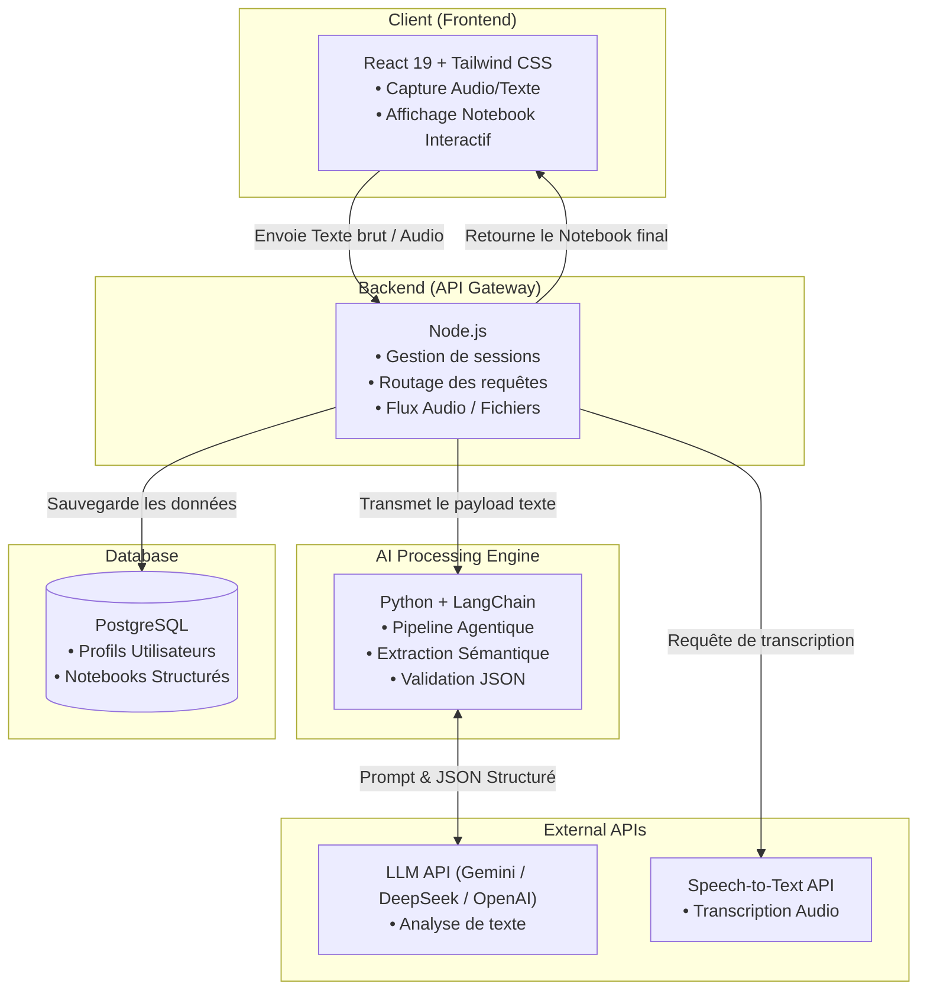

<div align="center">

# 🧠 BrainOut (Notebook)

### *Your AI-Assisted "Second Brain" & Virtual Product Manager*

**Transform unstructured dictated or written thoughts into a structured, actionable project notebook in under 15 seconds.**

[](https://github.com/)
[](https://react.dev/)
[](https://www.typescriptlang.org/)
[](https://tailwindcss.com/)
[](https://vite.dev/)

</div>

---

## 💡 Motivation & Vision

Beaucoup de créateurs, développeurs et entrepreneurs ont des idées innovantes mais manquent de cadre pour les structurer, ce qui mène souvent à des projets abandonnés. Les outils de prise de notes classiques demandent un effort d'organisation manuel important devant une page blanche.

**BrainOut (`Notebook`)** résout ce problème en agissant comme un **Product Manager virtuel** :
- Au lieu de vous laisser concevoir seul l'architecture de votre pensée, l'IA analyse votre idée brute ("brain dump" écrit ou dicté à la voix).
- En **moins de 15 secondes**, elle génère un cahier de projet modulaire comprenant : une esquisse visuelle, un plan d'action MVP, les compétences à acquérir, les pièges à éviter et des questions de réflexion stratégique pour couvrir vos angles morts.

---

## 📊 Statut du Projet & Feuille de Route (Roadmap)

> **Statut global :** 🚧 **En cours de développement (Phase 3 / Prototype Frontend & Intégration IA)**

| Phase | Jalon (Milestone) | Livrables clés | Durée estimée | Statut |
| :--- | :--- | :--- | :---: | :---: |
| **Phase 1** | **Design & TRD** | Finalisation des contrats JSON de l'IA et de l'architecture système | Semaine 1 *(4j)* | ✅ **Terminé** |
| **Phase 2** | **Client Interface (UI/UX)** | Interface React + Tailwind CSS, capture texte & dictée vocale, 5 onglets | Semaines 3-4 *(12j)* | ✅ **Terminé** |
| **Phase 3** | **AI Pipeline (Client & Fallback)** | Intégration directe LLM (Gemini API) + moteur heuristique hors-ligne | Semaine 5 *(5j)* | 🚧 **En cours** |
| **Phase 4** | **Backend & Infrastructure** | Serveur Node.js, base de données PostgreSQL & agent Python/LangChain | Semaine 2 & 5 *(10j)* | ⏳ **À venir** |
| **Phase 5** | **Tests & Déploiement** | Tests d'intégration de bout en bout et mise en production finale | Semaine 6 *(4j)* | ⏳ **À venir** |

### Détail d'avancement des fonctionnalités

- [x] **1. Raw Thought Ingestion** : Saisie de texte libre et dictée vocale en temps réel (`Web Speech API`).
- [x] **2. Smart Notebook Generation** : Conversion automatique en document modulaire (étapes MVP, blocs clés, compétences, pièges).
- [x] **3. Interactive Reflection (Mentor)** : Questions ciblées générées par l'IA avec sauvegarde des réponses utilisateur pour affiner le projet.
- [x] **4. Minimalist Editing Interface** : Espace de travail épuré avec vue *Sketch* (style carnet d'architecte), checklists interactives, export Markdown/JSON et mode favoris.
- [x] **5. Dual AI Engine** : Connexion à l'API Google Gemini (`gemini-1.5-flash`) + moteur d'incubation local 100 % hors-ligne.
- [ ] **6. Backend & Persistance Cloud** : Migration du `localStorage` vers Node.js + PostgreSQL (profils utilisateurs et synchronisation multi-appareils).
- [ ] **7. Pipeline Agentique Avancé** : Microservice Python + LangChain dédié à l'extraction sémantique et la validation stricte des schémas JSON.

---

## ✨ Fonctionnalités Clés

### 🎙️ 1. Capture d'Idées ("Brain Dump" & Voice-to-Text)
- **Dictée vocale native** : Parlez librement, vos pensées sont transcrites en direct avec retour visuel.
- **Exemples de démarrage** : Testez l'application en un clic grâce aux idées pré-configurées.
- **Raccourcis rapides** : `Cmd/Ctrl + K` pour créer une nouvelle note à tout moment, `Cmd/Ctrl + Enter` pour lancer l'analyse.

### 📓 2. Carnet de Projet Modulaire en 5 Onglets
Chaque idée génère un espace de travail structuré autour de **5 vues complémentaires** :
1. **Sketch (Esquisse Visuelle)** : Mise en page inspirée d'un carnet de conception (jalons datés, blocs de travail numérotés, checklist de fonctionnalités et synthèse éditoriale). Permet aussi de **réévaluer et enrichir** le projet avec l'IA en ajoutant de nouveaux détails.
2. **Notebook (Plan d'Action MVP)** : Liste d'étapes concrètes à cocher avec barre de progression dynamique (et animation de confettis à 100 % 🎉) + les 3 piliers techniques du produit (*Core Blocks*).
3. **Mentor (Réflexion Interactive)** : L'IA agit comme un mentor produit en posant 3 questions critiques pour challenger votre idée et lever les zones d'ombre.
4. **Traps & Prerequisites** : Liste des compétences techniques à apprendre (*Skills to Learn*) et des erreurs classiques à éviter (*Traps to Avoid* : over-engineering, dispersion, etc.).
5. **Original Raw Idea** : Archive intacte de votre pensée brute initiale.

### 💾 3. Gestion des Données & Export
- **Persistance instantanée** : Sauvegarde automatique dans le navigateur (`localStorage`).
- **Export Markdown** : Copiez l'intégralité de votre cahier de charges formaté en Markdown en un clic.
- **Sauvegarde JSON** : Exportez et réimportez tous vos projets au format `.json` depuis les paramètres.

---

## 🏗️ Architecture du Système

### Architecture Actuelle (Client-Side & Direct AI)
L'application fonctionne actuellement de manière autonome côté client (SPA React) avec persistance locale et appel direct à l'API LLM ou au moteur de secours hors-ligne :



### Architecture Cible Complète (PRD / TRD)
Conformément au *Technical Requirements Document (TRD)*, l'architecture cible complète intègre un backend dédié et un pipeline agentique :



---

## 📄 Contrat de Données (JSON Blueprint)

Le cœur de l'application repose sur la transformation d'une chaîne de caractères non structurée en un objet JSON strict contenant les 4 piliers d'analyse (étapes, concepts, pièges, réflexions) :

```json
{
  "metadata": {
    "status": "completed",
    "analyzed_modality": "voice_or_text",
    "confidence_score": 0.95
  },
  "project_blueprint": {
    "title": "Clear short title (max 6 words)",
    "one_liner": "One sentence summary of core value",
    "key_steps": [
      {
        "step_order": 1,
        "title": "Define minimal core requirement",
        "description": "Concrete step 1",
        "status": "pending"
      }
    ],
    "learning_concepts": [
      {
        "concept_name": "Skill to acquire",
        "context": "Technical prerequisite for the MVP"
      }
    ],
    "pitfalls_to_avoid": [
      {
        "pitfall": "Over-engineering custom infrastructure prematurely",
        "mitigation": "Focus all efforts on solving the primary problem cleanly"
      }
    ],
    "reflection_questions": [
      "What is the single essential feature required for launch?",
      "How will you validate demand with 5 users this week?"
    ]
  }
}
```

---

## 🛠️ Stack Technique

| Couche | Technologies actuelles (v0.4) | Cible TRD (Full-Stack) |
| :--- | :--- | :--- |
| **Frontend** | React 19, TypeScript, Vite 8, Tailwind CSS v4 | React + Tailwind CSS |
| **Animations & UI** | Framer Motion, Lucide React, Canvas Confetti | — |
| **IA & LLM** | Google Gemini (`gemini-1.5-flash`) + Moteur Local | Python, LangChain, LLM APIs |
| **Reconnaissance Vocale** | `Web Speech API` native du navigateur | Speech-to-Text API dédiée |
| **Backend & Base de données** | `localStorage` + Import/Export JSON | Node.js + PostgreSQL |
| **Qualité de code** | Oxlint + TypeScript strict | Tests E2E & CI/CD |

---

## 🚀 Installation & Démarrage Rapide

### Prérequis
- **Node.js** (version 18 ou supérieure)
- **npm** (ou `pnpm` / `yarn`)

### 1. Cloner le dépôt et installer les dépendances

```bash
git clone <url-du-repo>
cd Notebook
npm install
```

### 2. Lancer le serveur de développement

```bash
npm run dev
```
L'application sera accessible sur `http://localhost:5173`.

### 3. Commandes utiles

```bash
npm run build     # Compiler TypeScript et générer le build de production
npm run preview   # Prévisualiser le build de production en local
npm run lint      # Vérifier la qualité du code avec Oxlint
```

---

## 🔑 Configuration de l'IA (Optionnel)

L'application fonctionne **immédiatement sans configuration** grâce à son moteur d'incubation local intégré. Pour activer l'analyse générative par IA :

1. Obtenez une clé API gratuite sur [Google AI Studio](https://aistudio.google.com/app/apikey).
2. Ouvrez l'application et cliquez sur **Settings** (icône d'engrenage en bas de la barre latérale).
3. Saisissez votre clé API (`AIzaSy...`) et cliquez sur **Save**.
4. *Note de confidentialité : Votre clé est enregistrée uniquement en local dans votre navigateur (`localStorage`) et n'est partagée avec aucun serveur tiers autre que l'API officielle de Google.*

---

## 📂 Structure du Projet

```text
Notebook/
├── src/
│   ├── components/
│   │   ├── BrainDumpZone.tsx   # Zone de saisie libre, dictée vocale & exemples
│   │   ├── ProjectView.tsx     # Vue projet en 5 onglets, checklists & export Markdown
│   │   ├── SettingsModal.tsx   # Configuration clé API Gemini & sauvegarde JSON
│   │   └── Sidebar.tsx         # Navigation latérale, recherche & favoris
│   ├── data/
│   │   └── mockProjects.ts     # Projets de démonstration pré-chargés
│   ├── services/
│   │   └── aiService.ts        # Appel API Gemini + moteur d'incubation local (fallback)
│   ├── types/
│   │   └── project.ts          # Interfaces TypeScript (ProjectIdea, NotebookSketchData...)
│   ├── App.tsx                 # État principal, persistance localStorage & raccourcis
│   └── main.tsx                # Point d'entrée de l'application React
├── package.json
├── tailwind.config.js
└── vite.config.ts
```

---

## 👤 Auteur

- **Gabin Flotat** — *Conception produit (PRD/TRD), Architecture & Développement Full-Stack*
