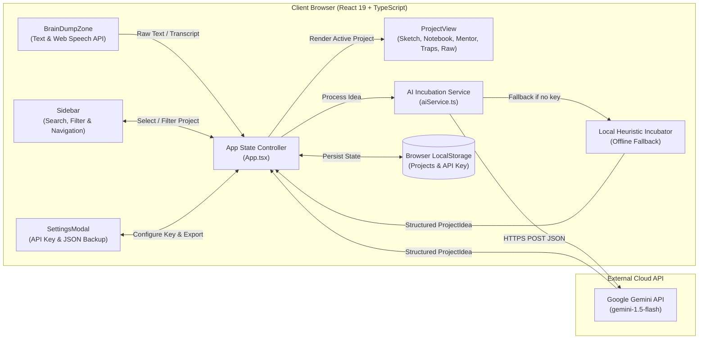

<div align="center">

# BrainOut — Notebook

**A "second brain" web application that transforms unstructured dictated or written thoughts into a structured, AI-assisted project notebook.**

<br />

[](https://react.dev/)
[](https://www.typescriptlang.org/)
[](https://tailwindcss.com/)
[](https://vite.dev/)
[](https://www.framer.com/motion/)
[](https://ai.google.dev/)
[]()

</div>

<br />

## Overview & Motivation

Many individuals have innovative ideas but lack the framework to structure them, often leading to abandoned projects. Existing note-taking alternatives require significant manual organization in front of a blank page.

**BrainOut (`Notebook`)** solves this by acting as a **virtual product manager**. Instead of leaving the user to design their thought architecture alone, the application analyzes a raw, unstructured prompt—written or dictated via voice—and automatically generates a modular project notebook containing an visual architectural sketch, an actionable MVP plan, core technical concepts to learn, strategic framing questions, and common pitfalls to avoid.

<br />

---

<br />

## Project Status

The project is currently **in active development**. Core interface components and data models are completed, while the main application state orchestration, AI service integration, and settings management are currently being finalized.

### Completed

- [x] **Data Models & Demo Dataset** (`src/types/project.ts`, `src/data/mockProjects.ts`) — Strict TypeScript interfaces for project blueprints, visual sketch layouts, and pre-loaded sample ideas.
- [x] **Brain Dump & Voice Ingestion Zone** (`src/components/BrainDumpZone.tsx`) — Unstructured text input, real-time browser speech-to-text transcription (`Web Speech API`), live voice waveform indicators, and starter prompts.
- [x] **Modular 5-Tab Project Workspace** (`src/components/ProjectView.tsx`) — Interactive workspace featuring the visual *Sketch* layout, *Notebook* MVP checklist with confetti feedback, *Mentor* Q&A reflection inputs, *Traps & Prerequisites* view, and *One-click Markdown export*.
- [x] **Navigation Sidebar** (`src/components/Sidebar.tsx`) — Collapsible project explorer with real-time search, favorites filtering, and MVP progress badges.

### In Progress / Upcoming

- [ ] **AI Structuring Engine** (`src/services/aiService.ts`) — Direct client-side integration with the Google Gemini API (`gemini-1.5-flash` with JSON response mode) paired with an offline heuristic fallback engine.
- [ ] **Settings & Data Portability Modal** (`src/components/SettingsModal.tsx`) — Interface for managing the user's Gemini API key and exporting/importing project backups as JSON files.
- [ ] **Core Application State & Persistence** (`src/App.tsx`) — Global state orchestration, automatic `localStorage` synchronization, and global keyboard shortcuts (`Cmd/Ctrl + K`).

<br />

---

<br />

## Key Features

### 1. Raw Thought Ingestion (Voice & Text)
Capture ideas on the fly without worrying about formatting. Built on the native browser `SpeechRecognition` / `webkitSpeechRecognition` API, the interface transcribes spoken thoughts in real time with interim transcript previews, or accepts raw written brain dumps.

### 2. Modular 5-Tab Project Notebook
Every structured idea is organized into five focused views inside `ProjectView`:
- **Sketch** — A visual blueprint inspired by an architect's notebook (milestones, numbered core work blocks, feature checklists, and editorial summary), complete with an interactive input to enrich and re-evaluate the project with additional thoughts.
- **Notebook** — An actionable MVP checklist with a dynamic progress bar, interactive step completion (celebrated with `canvas-confetti`), and core architectural blocks.
- **Mentor** — Targeted strategic framing questions where users can write and save their own answers to address conceptual blind spots.
- **Traps & Prerequisites** — A curated list of technical skills to acquire (*Skills to Learn*) and common product mistakes to avoid (*Traps to Avoid*).
- **Original Raw Idea** — Preserves the initial unstructured prompt for reference, alongside a one-click **Copy as Markdown** exporter.

### 3. Dual Incubation Engine (Gemini API + Offline Fallback)
Designed in TypeScript to run directly in the browser with sub-15-second generation times:
- **Live Gemini Mode** — Calls the `gemini-1.5-flash` REST endpoint with `responseMimeType: "application/json"` to transform raw text into a structured `ProjectIdea` object.
- **Local Heuristic Engine** — If no API key is configured or the user is offline, a built-in local incubator analyzes keywords (SaaS, Mobile, Audio/Voice, AI) to generate a complete project structure seamlessly.

<br />

---

<br />

## System Architecture

The application is built as a client-side Single Page Application (SPA) in React and TypeScript, communicating directly with browser APIs and the Google Gemini REST API.



<br />

---

<br />

## Tech Stack

- **Frontend Framework:** [React 19](https://react.dev/) with [TypeScript](https://www.typescriptlang.org/)
- **Build Tool:** [Vite 8](https://vite.dev/)
- **Styling:** [Tailwind CSS v4](https://tailwindcss.com/)
- **Animations & Micro-interactions:** [Framer Motion](https://www.framer.com/motion/) & [canvas-confetti](https://github.com/catdad/canvas-confetti)
- **Icons:** [Lucide React](https://lucide.dev/)
- **AI & Speech:** [Google Gemini API (`gemini-1.5-flash`)](https://ai.google.dev/) & Browser `Web Speech API`
- **Linting:** [Oxlint](https://oxc.rs/)

<br />

---

<br />

## Getting Started

### Prerequisites

- **Node.js** (v18+ recommended)
- **npm** (or `pnpm` / `yarn`)

### Installation

```bash
# 1. Clone the repository
git clone <repository-url>
cd Notebook

# 2. Install dependencies
npm install

# 3. Start the development server
npm run dev
```

Open `http://localhost:5173` in your browser to view the application.

### Available Scripts

```bash
npm run dev       # Launch Vite development server with HMR
npm run build     # Type-check with TypeScript and build for production
npm run preview   # Locally preview the production build
npm run lint      # Run Oxlint static analysis
```

<br />

---

<br />

## Project Structure

```text
Notebook/
├── src/
│   ├── components/
│   │   ├── BrainDumpZone.tsx   # Voice dictation & unstructured text input view
│   │   ├── ProjectView.tsx     # 5-tab project workspace & Markdown export
│   │   ├── Sidebar.tsx         # Collapsible navigation, search & favorites
│   │   └── SettingsModal.tsx   # [In Progress] API key config & JSON import/export
│   ├── data/
│   │   └── mockProjects.ts     # Initial sample projects for immediate testing
│   ├── services/
│   │   └── aiService.ts        # [In Progress] Gemini 1.5 Flash client & local fallback
│   ├── types/
│   │   └── project.ts          # Core TypeScript interfaces (ProjectIdea, TabType, etc.)
│   ├── App.tsx                 # [In Progress] State management & localStorage sync
│   └── main.tsx                # Application entry point
├── package.json
├── tailwind.config.js
└── vite.config.ts
```

<br />

---

<br />

## Author

**Gabin Flotat** — *Product Design, Architecture & Frontend Engineering*
